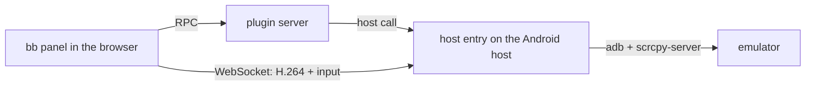

# Android Emulator for bb

Watch and control Android emulators that run on your bb hosts, right inside bb:
live screen, touch, keyboard, Unicode paste, clipboard sync and system buttons.
Agents get the same controls through `bb android-emulator`.

## How it works



- The plugin server lists your bb hosts; you pick one in the panel. One device
  stream is active per host.
- The host entry runs inside the bb host worker. It checks the Android SDK,
  lists AVDs and devices, starts an AVD headless and pushes the bundled
  scrcpy-server 3.3.3 to the device.
- The browser decodes H.264 with WebCodecs and sends touch, keys and text back
  over the same WebSocket. Each connection needs a one-time token (60 s) and the
  panel's exact Origin.
- A session nobody watches for 2 minutes closes. The emulator keeps running
  until you stop it.

## Requirements

On the Android host (Windows or Linux; macOS is untested):

- bb host enrolled and online.
- Android SDK with `platform-tools` and `emulator`, found through
  `ANDROID_HOME`, `ANDROID_SDK_ROOT` or the default SDK location.
- At least one AVD.
- Hardware acceleration (`emulator -accel-check` passes): WHPX/AEHD on Windows,
  KVM on Linux.

The plugin only checks these. It does not install the SDK, system images or
KVM, and does not create or change AVDs. The panel shows each failed check with
a hint.

In the browser: WebCodecs with H.264 (current Chromium, Firefox or Safari).

## Connection

Settings → Plugins → Android Emulator → Connection:

| Mode | Path | Needs |
| --- | --- | --- |
| BB network (default) | `wss://…` through `bb connect` shared ports | bb opened at getbb.app |
| LAN / VPN | `ws://ADDRESS:PORT` straight to the host | Browser reaches the host; Chromium asks for local network access from an HTTPS page |

LAN / VPN uses plain `ws://` on purpose: it is meant for a trusted local or VPN
network. Set **LAN / VPN address** when the host has more than one IPv4 address.
**Viewer port** defaults to 6090.

## Agent commands

Commands target the host chosen in the panel unless `--host` is given.
`--serial` defaults to the active device. Every command accepts `--json`.

```sh
bb android-emulator hosts
bb android-emulator list
bb android-emulator start Pixel_6_API_34
bb android-emulator key --key back|home|recent
bb android-emulator paste 'Text for the focused field'
bb android-emulator stop emulator-5554
```

`stop` shuts the emulator down; unsaved state may be lost. Do not pass secrets
through `paste`: arguments stay in shell history. Type them in the panel.

## Install

```sh
bb plugin install git:https://github.com/nicolay-i/bb-plugin-android-emulator.git@host-entry-scrcpy
```

## Development

```sh
npm ci
npm run check   # TypeScript
npm test        # unit tests + i18n dictionaries
npm run build   # bb plugin build
```

On Windows, `bb plugin build` (bb 0.46.1) fails with
`Cannot find module 'npm/package.json'`. Workaround:

```sh
NODE_PATH="$(npm root -g)" bb plugin build
```

Other scripts:

- `npm run embed:scrcpy-server` — download, verify and embed scrcpy-server.
- `npm run notices` — regenerate `THIRD_PARTY_NOTICES.md` after dependency
  changes.

## License

MIT. Bundled third-party components and their licenses are listed in
[THIRD_PARTY_NOTICES.md](THIRD_PARTY_NOTICES.md); scrcpy-server is Apache-2.0.
